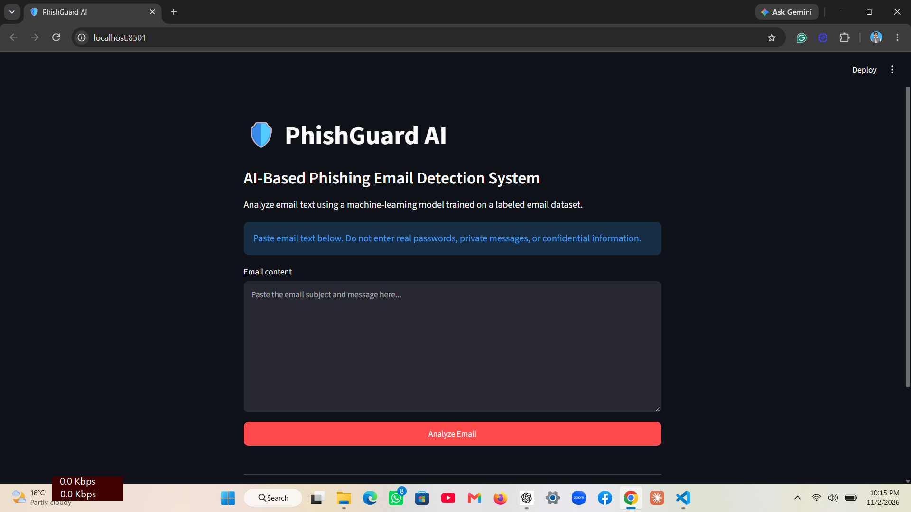
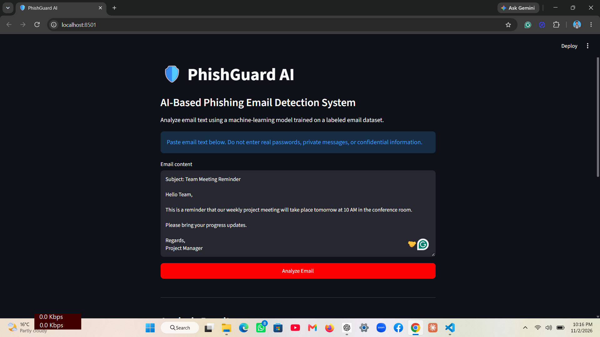
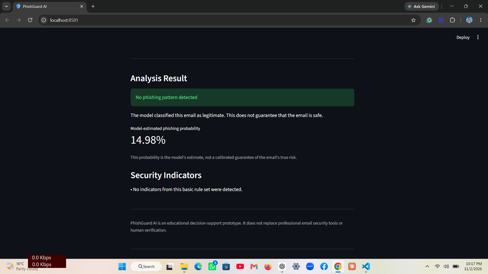
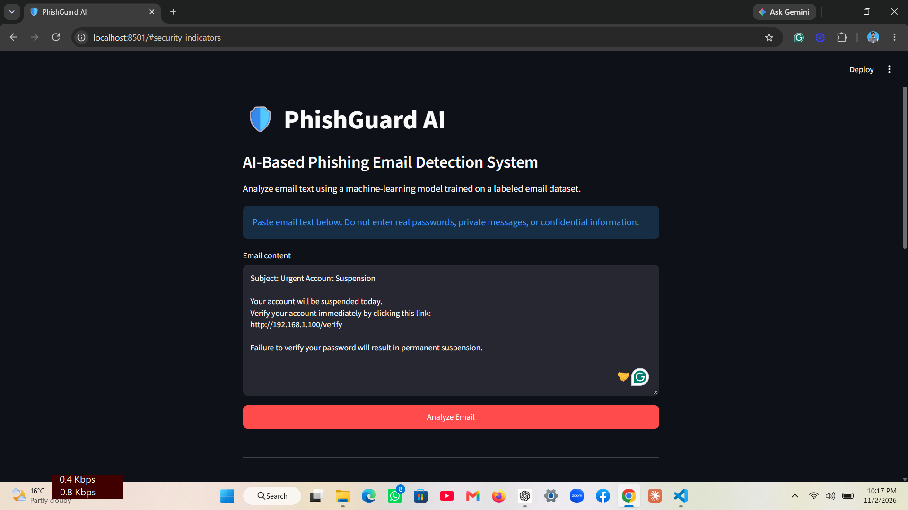
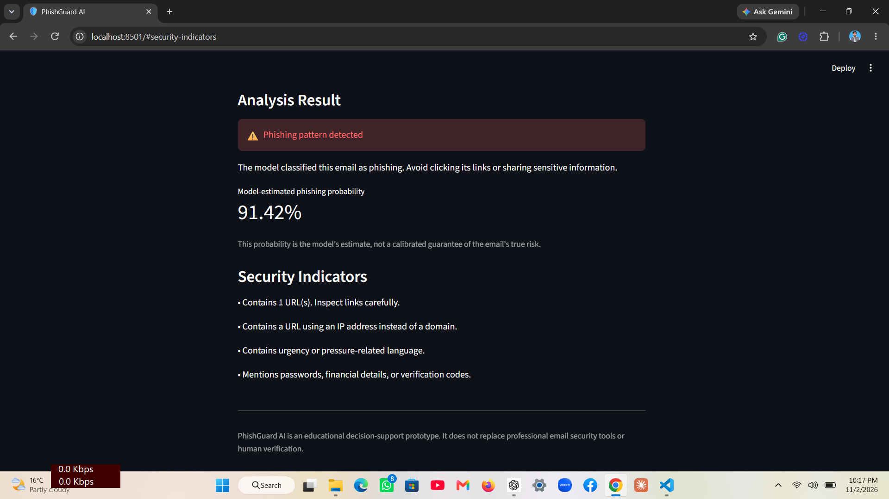
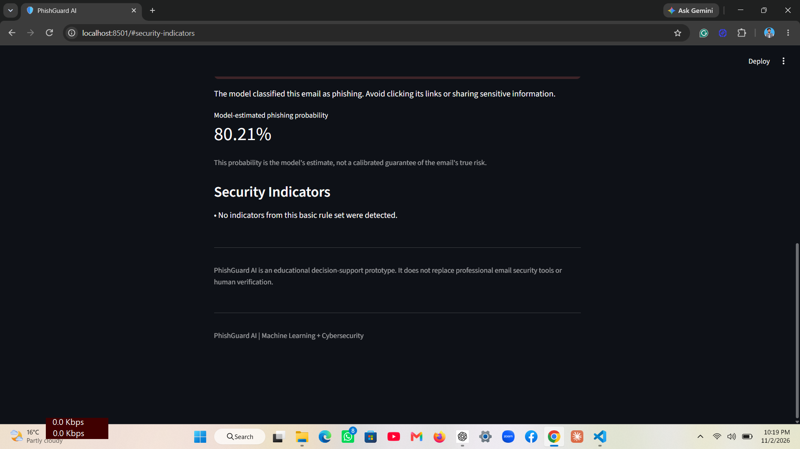
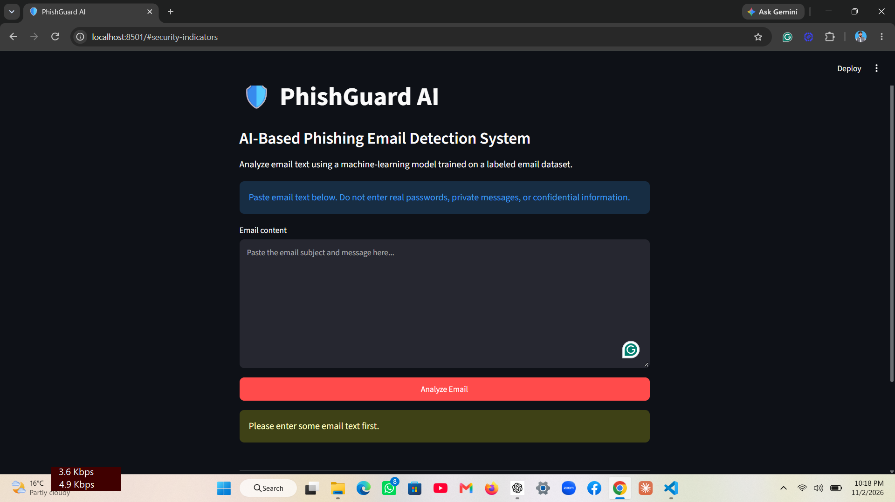
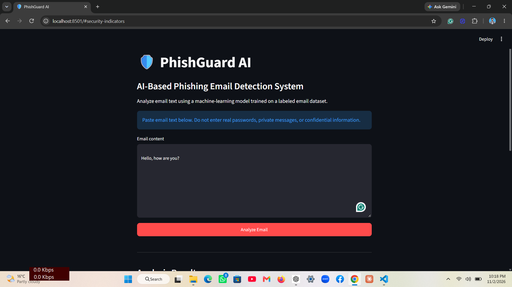

# PhishGuard AI 🛡️

**PhishGuard AI** is a machine-learning-based phishing email detection project built with Python, Scikit-learn, and Streamlit.

It analyzes email text and predicts whether an email is likely to be **phishing** or **legitimate**. It also displays an estimated phishing probability and basic text-based security indicators.

> **Disclaimer:** This is an educational decision-support prototype. It is not a replacement for professional email security software or human security review.

## Features

- Phishing and legitimate email classification.
- TF-IDF text feature extraction.
- Logistic Regression classification model.
- Estimated phishing probability.
- Basic security indicators, including:
  - URL detection.
  - IP-address-based URL detection.
  - Urgency-related language.
  - Credential-related language.
  - Exclamation mark detection.
- Input validation for empty email text.
- Input length limit.
- Model evaluation reports and confusion matrix.
- Streamlit-based user interface.

## Application Screenshots

### Homepage



### Legitimate Email Detection





### Phishing Email Detection





### Security Indicators



### Input Validation





## Machine Learning Approach

The project uses a Scikit-learn Pipeline consisting of:

1. **TF-IDF Vectorizer:** Converts email text into numerical features.
2. **Logistic Regression:** Classifies the extracted features as phishing or legitimate.

The vectorizer uses unigrams and bigrams, English stop-word removal, a maximum feature limit of 50,000, and sublinear term frequency scaling.

The model uses class balancing and a maximum of 1,000 iterations.

## Dataset

The project uses the Phishing Email Detection dataset available on Kaggle:

https://www.kaggle.com/datasets/subhajournal/phishingemails

The original dataset contains email text and email-type labels. The preparation script:

- Removes missing and empty email text.
- Validates the expected labels.
- Removes text shorter than 10 characters after normalization.
- Removes normalized email texts with conflicting labels.
- Removes repeated normalized email texts.
- Converts labels into `legitimate` and `phishing`.

The cleaned dataset contains **17,508 records**:

- Legitimate: 10,975
- Phishing: 6,533

The dataset is not included in this repository. Obtain it from the original Kaggle source and review its current license and usage terms before downloading or redistributing it. The local dataset and trained model are excluded from Git.

## Model Evaluation

The model was evaluated using an 80/20 stratified train-test split with random state 42.

| Metric | Result |
|---|---:|
| Accuracy | 98.37% |
| Phishing Precision | 97.42% |
| Phishing Recall | 98.24% |
| Phishing F1-score | 97.83% |

### Confusion Matrix

| Actual / Predicted | Legitimate | Phishing |
|---|---:|---:|
| Legitimate | 2161 | 34 |
| Phishing | 23 | 1284 |

The evaluation shows performance on a held-out portion of the same dataset. It does not establish real-world performance on new email sources.

## Project Structure

```text
PhishGuard-AI/
│
├── app.py
├── prepare_data.py
├── train_model.py
├── audit_dataset.py
├── inspect_conflicts.py
├── generate_report.py
├── requirements.txt
├── README.md
├── .gitignore
│
├── data/
│   ├── raw/
│   └── processed/
│
├── models/
│
├── reports/
│   ├── metrics.json
│   ├── classification_report.txt
│   └── confusion_matrix.png
│
└── screenshots/
```

The `data/` and `models/` directories contain local files and are intentionally excluded from version control.

## Installation and Setup

### 1. Clone the repository

```bash
git clone https://github.com/YOUR-USERNAME/PhishGuard-AI.git
cd PhishGuard-AI
```

Replace `YOUR-USERNAME` with your GitHub username.

### 2. Create a virtual environment

```bash
python -m venv .venv
```

Activate it on Windows PowerShell:

```powershell
.\.venv\Scripts\Activate.ps1
```

### 3. Install dependencies

```bash
python -m pip install -r requirements.txt
```

### 4. Download the dataset

Download the original dataset from Kaggle and place the CSV file at:

```text
data/raw/Phishing_Email.csv
```

The CSV must contain the columns `Email Text` and `Email Type`.

### 5. Prepare the dataset

```bash
python prepare_data.py
```

This generates:

```text
data/processed/phishing_emails_clean.csv
```

### 6. Train the model

```bash
python train_model.py
```

This creates the trained model locally in:

```text
models/phishguard_model.joblib
```

### 7. Run the application

```bash
streamlit run app.py
```

The application will open in your browser.

## Limitations

- Predictions are based on patterns learned from the training dataset.
- The phishing probability is a model estimate, not a guarantee.
- Security indicators are simple text-based checks, not a complete threat analysis.
- A legitimate email can be incorrectly flagged as phishing (false positive).
- A phishing email can be incorrectly classified as legitimate (false negative).
- Performance on this dataset may differ from performance on real-world emails.
- The application does not verify URLs, inspect attachments, or authenticate email senders.

## Technologies Used

- Python
- Scikit-learn
- TF-IDF
- Logistic Regression
- Pandas
- Matplotlib
- Joblib
- Streamlit

## Author

**Muhammad Shayan Ahmad**

BS Computer Science

## Project Purpose

PhishGuard AI was developed as a learning and portfolio project combining machine learning and cybersecurity to explore automated phishing email detection.
